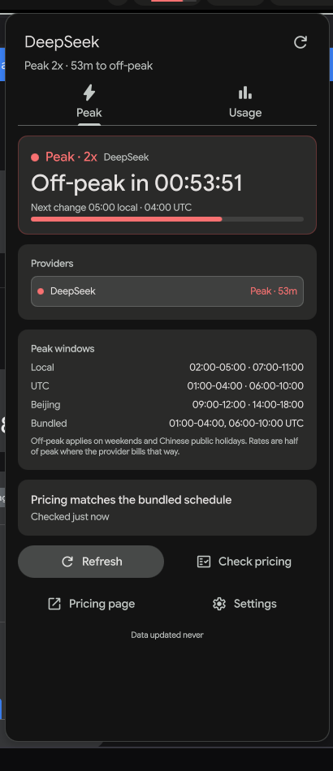

# DeepSeek for Dux

[](LICENSE)

A single lightweight Dux / DMS plugin that shows:

- **Peak and off-peak API pricing** for DeepSeek with a live countdown, progress
  gauge and both-provider overview (DeepSeek and Ollama Cloud).
- **Balance and usage** — official API balance, granted/topped-up split, 24h and
  month change, current-month tokens and cost, a daily token chart and monthly
  history.
- **Pricing drift alerts** — checks the public pricing page and warns when the
  published peak windows no longer match the bundled schedule.

No Python, Electron, Playwright, curl or jq. The plugin is pure QML/JavaScript;
network requests use Qt's `XMLHttpRequest`, and the peak schedule is computed
locally.

## Screenshot



## Install

```bash
git clone https://github.com/opigod/dux-deepseek.git ~/.config/dms/plugins/DeepSeek
```

Then:

1. Open **Settings → Plugins**, scan if needed, and enable **DeepSeek**.
2. Open **Settings → Bar → Widgets** and add the DeepSeek widget to a bar or dock.
3. Open the plugin settings (gear icon next to DeepSeek in the plugin list) and
   add credentials.

## Credentials

### API key (balance)

Create a key at <https://platform.deepseek.com/api_keys> and paste it into the
plugin settings. The key is used for `GET https://api.deepseek.com/user/balance`.
If the field is empty, the `DEEPSEEK_API_KEY` environment variable is used.

### Platform session token (monthly usage)

The official API does not expose account-level usage. Monthly tokens, cost,
token estimate and the daily chart come from the platform's own endpoints and
need a logged-in session:

1. Open <https://platform.deepseek.com/usage> and sign in.
2. Press `F12`, open **Network**, and filter for `get_user_summary`.
3. Click the request and copy the `authorization` request header (or the full
   `cookie` header).
4. Paste it into **Platform session token** in the plugin settings.

The token is masked in the UI, never logged, and stored only in the gitignored
`~/.config/dms/plugin_settings.json`. It expires when the platform logs you out;
the plugin then shows a re-paste warning and stops retrying with the old token.

## Settings

| Setting | Default | Description |
| --- | --- | --- |
| Bar display | Peak + balance | Peak + balance, peak only, balance first, or icon only. |
| Show block progress | on | Thin line under the countdown. |
| Off-peak / peak / drift color | green / red / amber | Pill and status colors. |
| Peak schedule provider | DeepSeek | DeepSeek or Ollama Cloud. |
| Show Ollama Cloud | on | Show Ollama's schedule in the Providers card. Turning it off switches the active schedule back to DeepSeek. |
| Check the pricing page | on | Fetches the public pricing page for drift detection. |
| Pricing check interval | 6 h | 1–24 hours. |
| Offline only | off | Disable every network request; the countdown keeps working. |
| Custom pricing page URL | empty | Optional mirror for drift checks. |
| API key | empty | Official balance endpoint. |
| Platform session token | empty | Monthly usage, cost and chart. |
| Refresh interval | 5 min | 1–60 minutes. |
| History | 3 months | Current month, 3 months or 6 months. |

## Schedule and holidays

Bundled schedule (checked against the public pages in November 2026):

- **DeepSeek**: peak **01:00–04:00 and 06:00–10:00 UTC, Monday–Friday**.
  Off-peak weekends and Chinese public holidays.
- **Ollama Cloud**: peak **12:00–18:00 UTC, Monday–Friday**. Off-peak weekends.

Chinese holiday dates are bundled for 2025 and 2026. The date list is not a
substitute for the provider's current policy; a drift warning only tells you the
published page changed, it does not silently reprice anything.

## IPC

```bash
dms ipc call deepseek status
dms ipc call deepseek refresh
dms ipc call deepseek checkPricing
dms ipc call deepseek getProvider
dms ipc call deepseek setProvider ollama
```

`status` returns peak state, balance numbers, drift state and timestamps. It
never returns the API key or platform token.

## Performance

- One daemon shared by every bar/dock instance; a cached snapshot renders
  instantly.
- Default five-minute refresh: one balance request, four platform requests;
  older months are fetched once per day; pricing drift every six hours.
- Balance history is capped at about one point per hour for 32 days.
- The daily chart is created only while the Usage tab is open.
- No subprocesses, no background polling when offline-only is on, and no
  credentials means no usage requests.

## Development

```bash
cd ~/.config/dms/plugins/DeepSeek
bun test
dms ipc call plugins reload deepseek
journalctl --user -u dms -f
```

The schedule and parsing modules are plain JavaScript and are also run under
Bun for boundary, holiday, DST and fixture tests.

## Credits

Feature inspiration and pricing logic:

- [noctalia-dev/community-plugins — deepseek-peak](https://github.com/noctalia-dev/community-plugins/tree/main/deepseek-peak) (MIT)
- [gylove1994/deepseek-dms-widget](https://github.com/gylove1994/deepseek-dms-widget) (MIT)
- [juliuswms/dms-deepseekbalance](https://github.com/juliuswms/dms-deepseekbalance) (MIT)

Holiday data: [NateScarlet/holiday-cn](https://github.com/NateScarlet/holiday-cn) (MIT), Beijing calendar.

This plugin is not affiliated with or endorsed by DeepSeek. It uses the
platform's internal usage endpoints, which may change without notice.

## License

MIT — see [LICENSE](LICENSE).
